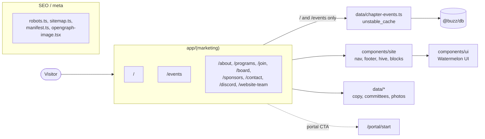
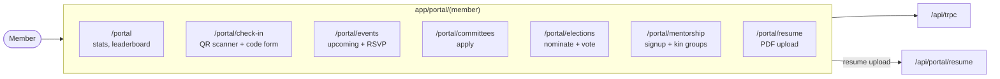
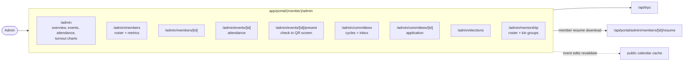
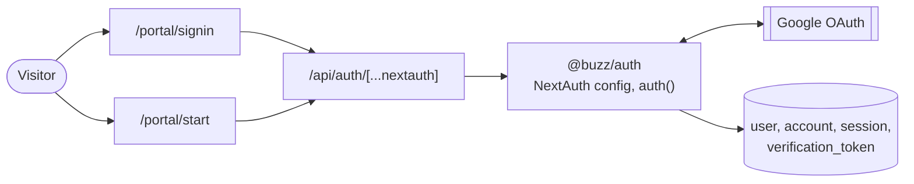
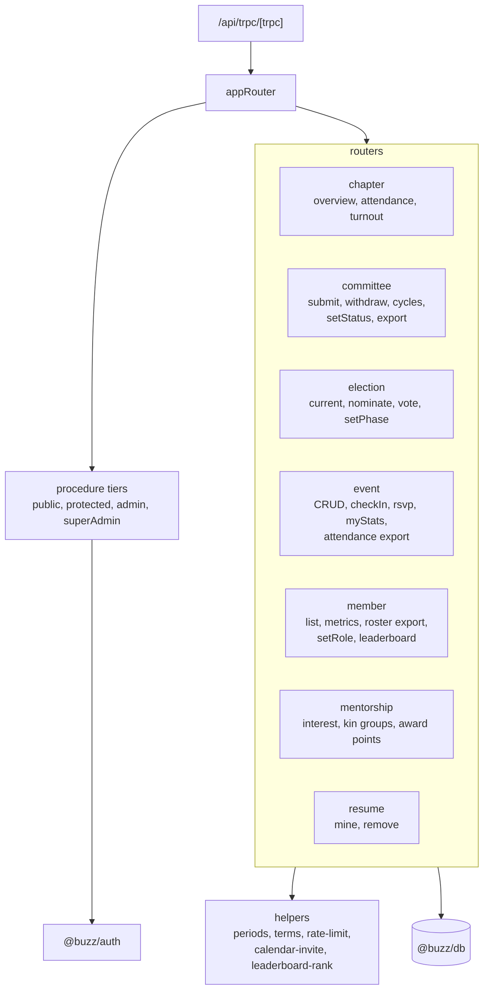
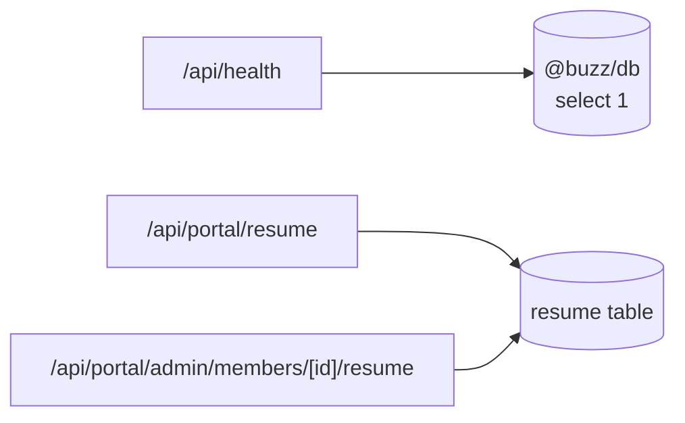
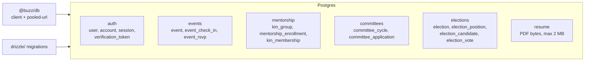

# Site structure

How the public site, member portal, API routes, workspace packages, and database fit
together. The README has the one-diagram overview; each section below zooms into one part.

- [Public site](#public-site)
- [Member portal](#member-portal)
- [Portal admin](#portal-admin)
- [Sign-in](#sign-in)
- [API](#api)
- [Database](#database)

## Public site

`app/(marketing)` is prerendered and never reads the session. Only `/` and `/events` touch
the database, through the cached calendar query.

## Member portal

`app/portal/(member)` needs a session. Pages call tRPC through the client mounted in
`app/portal/layout.tsx`; the resume upload goes through its own route handler.

## Portal admin

`app/portal/(member)/admin` is gated to the admin role. Role changes need super admin.

## Sign-in

Google is the only provider. `/portal/start` is where the public site's CTAs land.

## API

`/api/trpc` serves `appRouter` from `@buzz/api`. Every procedure runs at one of four
access tiers; the shared helpers live beside the routers.

Other route handlers:

## Database

Postgres through Drizzle. Every table is prefixed `buzz_`; migrations live in
`packages/db/drizzle`.

