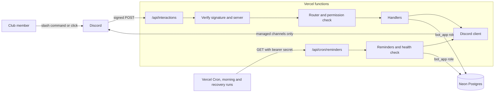

# SASE at GT Events Bot

A Discord bot for the SASE at Georgia Tech events team. It stores events, tasks and deadlines, creates a forum post for each event, and reminds each person about their own tasks.

This is the `sites/discord-bot` workspace of the buzz monorepo (`@buzz/discord-bot`), imported from GT-SASE/discordBot with its history. It shares buzz's lockfile, tooling and CI, and deploys as its own Vercel project. Run the commands below from the repository root with `bun run --cwd sites/discord-bot <script>`, or from this folder.

It runs on free tiers: TypeScript functions on Vercel Hobby and Postgres 17 on Neon. It has no always-on server and no website.

**Status: v2, before launch.** It is set up fresh on the club's own accounts with [docs/SETUP.md](docs/SETUP.md), and [docs/STAGING_CHECKLIST.md](docs/STAGING_CHECKLIST.md) lists the smoke checks to pass before it joins the club's server.

## What it does

An officer creates an event, and the bot opens a post for it in a forum. The officer assigns tasks, and the bot pings each person in that post:

```text
/task assign person:@Sam description:Book the room due:11/20

@Sam, you have a new task:
Book the room
Due 2026-11-20. Task 1a2b3c4d, given by @Alex.
[✅ Mark done]
```

The bot then reminds the person 3 days before, 1 day before, on the due day and once when overdue. After a missed run, only the most urgent reminder goes out. Each reminder has a Mark done button too, labelled with the start of the task.

Each event also gets countdown pings in its post from the same morning run. E is the event's day:

| When                 | Who                                       | Only if                                           |
| -------------------- | ----------------------------------------- | ------------------------------------------------- |
| E−35                 | Events Directors                          | nobody is on an open Budget Sheet or Engage post  |
| E−28                 | the people on Budget Sheet or Engage post | someone is on it and it is not done               |
| E−21                 | those people and Events Directors         | not done                                          |
| Engage done + 7 days | Marketing Committee                       | Engage picture not added                          |
| E−7                  | Marketing Committee                       | always                                            |
| E−7                  | Events Directors                          | nobody on Slides, and it is not marked not needed |
| E−7                  | Events Directors                          | Food pickup has no time or nobody on it           |
| Saturday before E    | Marketing Committee                       | E is not a Saturday                               |
| E−2 and E−1          | the people on Slides                      | someone is on Slides and it is still open         |
| E−2 and E            | the people on Food pickup, with the time  | Food pickup has a time and a person               |
| E                    | Events Directors and Events Committee     | always                                            |

Closed events get none. None of these go out late: a day's ping is sent on that day or not at all, so an event made after a ping's day skips it.

Members see their own open tasks with `/mytasks`, privately:

```text
Your open tasks, soonest first
- 1a2b3c4d, due 2026-11-20, Spring Social: Book the room
```

Each event also follows the club's own steps, shown as a checklist in its overview: Budget Sheet, Engage post, Engage picture added, Budget approved, Slides and Food pickup. Engage picture added shows once Engage post is done. Officers put people on steps with `/event assign`, or with the `budget` and `engage` options of `/event create`, and the bot pings each person in the post. The checklist shows who is on each step and has a button for each step still open:

```text
Checklist
✅ Budget Sheet: @Sam
⬜ Engage post: @Lee
⬜ Budget approved
⬜ Slides: nobody assigned
⬜ Food pickup: time not set, nobody assigned
[Engage post done] [Budget approved] [Slides done] [No slides needed]
```

When Budget Sheet is marked done, the bot pings the Treasury Committee role once in the post. When the Engage post is marked done, it pings the Marketing Committee role. An officer or the Treasury Committee marks the budget approved, and the bot notes in the post that the budget is approved, without pinging anyone. Engage picture added, Slides done and No slides needed ping nobody. An officer can reopen a step with `/event undo`, which notes it in the post. Putting someone on Slides undoes No slides needed, and notes that too. Food pickup can be set up at any time: a time with `/event pickup`, and people with `/event assign step:Food pickup`. `/mytasks` lists your open steps and food pickups too, upcoming events soonest first, then any step still open on an event that has passed.

The names, dates and ID above are made up.

Admins configure the bot inside Discord: which forums it may post in, and whether reminders are on. Channels and roles are chosen after launch, and none are written into the code.

## Architecture



The bot receives Discord's HTTP interactions and opens no gateway connection. It sees only what it is sent, so it cannot react to messages, role changes or members leaving. [Record 2](docs/adr/0002-http-interactions-on-serverless.md) explains this choice.

Discord allows 3 seconds for the first reply. So the bot makes one database read, sends a private acknowledgement, and finishes the work with `waitUntil`.

| Path             | Holds                                                      |
| ---------------- | ---------------------------------------------------------- |
| `api/`           | The two public endpoints. Every file here becomes a route. |
| `src/discord/`   | Signature checks, safe text, message builders, REST client |
| `src/handlers/`  | The router and each command                                |
| `src/tasks/`     | The `/task` subcommands                                    |
| `src/events/`    | Event input checks, the overview and the event's steps     |
| `src/reminders/` | The daily run, its plan and the health check               |
| `src/db/`        | All database access                                        |
| `src/lib/`       | Settings, permissions and dates                            |
| `db/drizzle/`    | The schema (Drizzle), and the role and grants              |
| `scripts/`       | Migrations, command registration and the repo's checks     |
| `docs/adr/`      | Records of the design decisions and their costs            |

## Commands

Tiers come from the signed request each time, and nothing is cached. Every command except `/ping` and `/setup` refuses until `/setup` has been run. Replies are private unless noted.

| Command         | Who can use it                | What it does                                              |
| --------------- | ----------------------------- | --------------------------------------------------------- |
| `/ping`         | Any member                    | Checks the bot answers. Needs no setup or database.       |
| `/mytasks`      | Any member                    | Lists your own open tasks, steps and food pickups.        |
| `/task done`    | The assignee, or an officer   | Marks a task done. The Mark done button does the same.    |
| `/task assign`  | Officer                       | Creates a task and pings the person in the post.          |
| `/task edit`    | Officer                       | Changes the description, due date or person.              |
| `/task delete`  | Officer                       | Soft-deletes a task, after a Confirm click.               |
| `/task reopen`  | Officer                       | Reopens a task marked done.                               |
| `/event create` | Officer                       | Creates an event and its forum post.                      |
| `/event link`   | Officer                       | Makes the post you are in the home of an event.           |
| `/event status` | Officer                       | Shows an event and its tasks.                             |
| `/event list`   | Officer                       | Lists events in every managed forum.                      |
| `/event close`  | Officer                       | Closes an event and stops its reminders.                  |
| `/event delete` | Officer                       | Soft-deletes an event and its tasks, after a Confirm.     |
| `/config`       | Admin                         | Forums, reminders, the five roles and the last 5 changes. |
| `/setup`        | Administrator permission only | Chooses the five club roles, after a Confirm click.       |

`/setup` chooses five roles: E-board, Events Directors, Events Committee, Treasury Committee and Marketing Committee. The club has no separate admin role: E-board is the admin, so `/setup` saves the E-board role as the admin role too, and `/config` shows it as `E-board (also admin)`. An officer holds the Events Directors or E-board role, or is an admin. An admin holds the E-board role or Discord's Administrator permission. The E-board role does not reach `/setup`. A server whose saved admin role differs from E-board keeps it until `/setup` is run again, and `/config` shows it on its own line. Treasury Committee is pinged when a Budget Sheet is done and can approve budgets. Marketing Committee is pinged when an Engage post is up. Events Committee is shown in `/config` and decides nothing yet. A server set up before these roles existed keeps working, and `/config` says to run `/setup` for each role still missing.

The event's steps have their own commands and buttons:

| Command or button                           | Who can use it                         | What it does                                             |
| ------------------------------------------- | -------------------------------------- | -------------------------------------------------------- |
| `/event create` `budget:` `engage:`         | Officer                                | Puts one person each on Budget Sheet and Engage post.    |
| `/event assign`                             | Officer                                | Puts someone on a step and pings them in the post.       |
| `/event unassign`                           | Officer                                | Takes someone off one of an event's steps.               |
| `/event pickup`                             | Officer                                | Sets the food pickup time.                               |
| `/event undo`                               | Officer                                | Reopens a done step, or undoes No slides needed.         |
| **Budget Sheet done**, **Engage post done** | The people on that step, or an officer | Ticks the step and pings Treasury or Marketing once.     |
| **Budget approved**                         | Officer or Treasury Committee          | Ticks the step and notes it in the post, pinging nobody. |
| **Engage picture added**                    | Officer or Marketing Committee         | Ticks the step, pinging nobody.                          |
| **Slides done**                             | The people on Slides, or an officer    | Ticks the step, pinging nobody.                          |
| **No slides needed**                        | Officer                                | Marks Slides not needed, pinging nobody.                 |

The buttons are on the event's overview. Anyone else who clicks one gets the refusal privately, and the post stays as it is. Food pickup is done once it has a time and at least one person.

[Record 4](docs/adr/0004-role-based-permissions.md) has the reasoning.

## Security model

No system is unhackable, and this one makes no such claim. The aim is to keep the likely failures small and recoverable. [SECURITY.md](SECURITY.md) covers reporting a problem and what to do if a secret leaks.

**Incoming requests**

- Ed25519 signature checked on the raw bytes before parsing. Timestamps over 5 minutes old are refused.
- The request must be for this application, from a member of a server in `ALLOWED_GUILD_IDS`, in a guild install. Anything else is refused.
- The body is limited to 64 KB, and is refused early if declared larger.
- The cron endpoint needs a bearer secret of at least 32 characters. If it is unset or too short, every request is refused. Headers and user agents grant nothing.

**Authorization**

- Deny by default. `COMMAND_POLICY` maps each action to a tier, and a route with an unmapped action stops the app from loading.
- Routes are found in a `Map` by exact match. The same fixed refusal covers an unknown route, the wrong tier and a missing row.
- Rows are loaded by ID and the signed server, and checked. A `custom_id` or autocomplete value can name a row but grants nothing.
- A state-changing route claims the interaction once, so a replayed request changes nothing.

**Database**

- The bot logs in as `bot_app`, a role that owns nothing, belongs to no role and cannot create anything. It reaches Neon over HTTPS for reads and over a WebSocket for writes, which need a transaction. Its tables and migration record live in their own schema, `discord_bot`, inside buzz's database. `bot_app` has no privilege on buzz's tables in `public`, and buzz's Drizzle ignores `discord_bot`. No statement relies on `search_path`: each names `discord_bot`.
- `bot_app` has no `DELETE` or `TRUNCATE` anywhere, apart from deleting day-old rows of `interaction_claims`. It can read the app's tables and insert and update them: `events` and `tasks` as a whole, every other table only in the columns its writes change. The writes that check a version, a claim or a limit are TypeScript in `src/db`, run in a transaction that takes the row locks and checks what it read, and config changes also write an audit row. The database has no triggers: the row history, the task and reassignment quotas, a deleted row staying deleted, a closed event staying closed, a new event's steps and the time zone check are all the bot's code. What it enforces whoever writes is every constraint and key, the column grants and row-level security.
- The bot copies every changed row of the main tables into `discord_bot.row_versions` as it writes, which `bot_app` can add to but not change or remove.
- Deletes are soft. The one hard delete is the daily expiry of interaction claims, which removes day-old ones, short-lived tokens rather than club data. CI checks the grants on PGlite and on Postgres 17.

**Outgoing messages**

- User text reaches a message only after it is escaped, and every message is built by the same builder functions. Member names and nicknames are never rendered. Masked links and server invites are refused in task text and event names, including a post's title on `/event link`, and plain URLs are escaped so that nothing can click them. Invisible characters, such as zero-width and default-ignorable ones, are removed first, so they cannot hide one.
- Every message sets `allowed_mentions` to the named users and roles only, and suppresses link previews.
- Posts go through one client, which checks the channel or its parent is a managed forum in that server. CI fails on a direct Discord call anywhere else.
- The bot is invited with `permissions=0` and given View Channel, Send Messages and Send Messages in Threads, per forum. It also gets whatever the server gives `@everyone`, so keep that role narrow.

**Secrets and supply chain**

- Nothing logs a request body or interaction token. Logs hold fixed text, IDs and error codes.
- Gitleaks scans every commit in CI and the pushed commits in a pre-push hook, with the default rules plus three project rules in `config/gitleaks/gitleaks.toml`. `bun.lock` (the repository's) is committed and CI installs with `bun install --frozen-lockfile`. The bot's own dependencies are pinned to exact versions, Actions are pinned by SHA, and Dependabot has a 7-day cooldown with no auto-merge.

**Backups**

- Neon's point-in-time restore and branching, within the plan's restore window, plus an occasional manual `pg_dump` export kept privately. Soft deletes and row history undo single mistakes. See [docs/RECOVERY.md](docs/RECOVERY.md).

## Risks that remain

These stay true with every control working:

- **Discord admins.** A Discord Administrator can give themselves every tier. Anyone who can manage roles can grant a bound role below their own, and the bot is not told when that happens.
- **Stolen secrets.** A leaked bot token or `DATABASE_URL` bypasses this code. Rotating stops further use, but what was done with it stays done: changed role bindings, managed forums and skipped reminders are not undone. Row history keeps the old bindings and forums, not the reminder log. Data read before then stays exposed. [SECURITY.md](SECURITY.md#2-check-for-misuse) lists the checks to make after a leak. Row history and Neon's restore recover events and tasks, which `bot_app` can still overwrite.
- **Account takeover.** A takeover of the maintainer's GitHub, Vercel, Neon or Discord account defeats all of this. So does a platform incident.
- **A trusted officer.** An officer, or a stolen officer account, can still ping people with persuasive plain text and a URL. It cannot be clicked, but it can be copied. Only a person can judge such text.
- **What officers can read.** An officer can see events through the bot in forums they cannot open in Discord.
- **Who did it.** Officer edits, completions and deletes record no actor, so after a stolen officer account they may not be traceable to it. [SECURITY.md](SECURITY.md#what-can-be-attributed) says what can be.
- **Autocomplete replay.** Discord takes autocomplete choices only in the HTTP response, so they cannot be deferred. Someone holding a captured signed request can replay it for 5 minutes and read current task or event text. Getting one needs a compromised host or proxy.
- **Floods.** A flood of requests can use up Vercel Hobby's limits and take the bot offline, in most cases for 30 days. It costs availability, not money. Hobby's firewall rules reduce this, and do not stop it.
- **Missed runs.** Vercel Cron is best effort with no retries. A second cron reduces this, but a reminder can be late or, after a crash, sent twice. An event's countdown pings, Food pickup included, are never late: if both crons of its day miss, they are not sent.
- **A refused post.** A locked post, or a bot that lost its permissions or was removed, fails the daily run every day until someone fixes it. Nothing alerts on a failed run, so [the runbook](docs/RUNBOOK.md#where-to-look) says what to check each week.
- **Dependencies.** A compromised dependency would run with full access to the secrets. Pinning and cooldowns lower the odds only.
- **Backups.** How far back Neon can restore depends on its plan. A former member's text stays in that history and in exports until they expire or are deleted.
- **Short logs.** Hobby keeps logs for one hour, which limits what can be learned after an incident.
- **Unproved.** Grants have been tested on PGlite and on Postgres 17 in CI, not on Neon, and no restore has been tried on Neon. See [docs/STAGING_CHECKLIST.md](docs/STAGING_CHECKLIST.md).

## Local development

You need the Bun version in the root `package.json` (`packageManager`), Node 24, Git, Bash and curl, on macOS or Linux. Bun installs packages and runs every script, test and CI step.

The code type-checks with TypeScript 7, installed as `typescript-7`, and with [tsrs](https://github.com/oxc-project/tsrs), its Rust port, as buzz does. tsrs is a beta, so it is pinned exactly and `bun run check` runs both. `typescript` stays on 6.x at the root, because typescript-eslint supports only versions below 6.1.

```sh
bun install --frozen-lockfile
bun run gitleaks:install
bun run hooks:install
```

Those last two run from the repository root. `bunfig.toml` here holds the test preload and applies to scripts run from this folder. `hooks:install` turns on a pre-push hook that runs gitleaks over the commits being pushed and blocks the push on a finding. [SECURITY.md](SECURITY.md) lists its limits.

There is no local bot. Discord needs a public HTTPS URL, so tests stand in for it, and real runs happen on the deployment, on a private test server. `.env.example` lists every setting. Copy it to `.env` only when you need to register commands.

### Tests and checks

| Command                       | What it does                                                                                                                                                                            | Needs                                                                         |
| ----------------------------- | --------------------------------------------------------------------------------------------------------------------------------------------------------------------------------------- | ----------------------------------------------------------------------------- |
| `bun run check`               | At the repository root: lint, typecheck, format, and the unit and PGlite tests of every workspace, through Turborepo, replaying any whose inputs are unchanged                          | Nothing                                                                       |
| `bun run typecheck`           | Type check with tsrs, the Rust port of TypeScript 7                                                                                                                                     | Nothing                                                                       |
| `bun run typecheck:tsc`       | Type check with TypeScript 7's `tsc`, the deciding check while tsrs is a beta                                                                                                           | Nothing                                                                       |
| `bun run lint`                | ESLint (only the clients may call `fetch`)                                                                                                                                              | Nothing                                                                       |
| `bun run format:check`        | Prettier                                                                                                                                                                                | Nothing                                                                       |
| `bun run test`                | Unit tests                                                                                                                                                                              | Nothing                                                                       |
| `bun run test:db`             | Migrations, grants and access layer on PGlite, logged in as `bot_app`                                                                                                                   | Nothing                                                                       |
| `bun run test:db:concurrency` | Races: double Done clicks, retried interactions, overlapping reminder runs, deletes against inserts, config saves and first setup, task quotas at their limit, task changes, lock order | `CONCURRENCY_DATABASE_URL` to a Postgres 17 superuser, and `BOT_APP_PASSWORD` |
| `bun run db:migrate`          | Applies new files in `db/drizzle` with drizzle-kit's migrator, in order, one run at a time                                                                                              | `DATABASE_URL` for the database's owner role, never `bot_app`                 |
| `bun run db:generate`         | Makes a migration from a change to `src/db/schema.ts`. Add `--custom` for one written by hand, such as a trigger or a grant                                                             | Nothing                                                                       |

Tests use `bun:test`. Unit tests sit next to the code as `src/**/*.test.ts` and `scripts/*.test.ts`, the PGlite tests are in `test/db/`, the race tests in `test/db-concurrency/`, and shared helpers in `test/support/`. Every run preloads `test/support/setup.ts`, which pins the time zone, undoes stubs after each test, and checks every body sent to Discord for live mentions and masked links. To run one file, give a path starting with `./`, since a bare word only filters file names:

```sh
bun test --isolate ./src/lib/dates.test.ts
bun test ./test/db/db-rules.test.ts
```

`bun run test:db` runs the migration files on PGlite and the tests run the bot's own writes against it as `bot_app`. `test/db/migrations.test.ts` migrates a database that already holds history in two steps and checks it comes out as a fresh one. The concurrency tests need real Postgres 17. CI's database workflow runs one as a service, makes an owner, a database and the `discord_bot` schema, runs `bun run db:migrate` twice, and once more as two at the same moment, sets `bot_app`'s password, then runs those tests through `pg`, logged in as `bot_app`, on the migrated database. Point `CONCURRENCY_DATABASE_URL` at the migrated database.

Gitleaks scans every commit on every ref, as CI does. You need a full clone.

```sh
test ! -e .gitleaksignore
.tools/gitleaks git . --config config/gitleaks/gitleaks.toml --redact --ignore-gitleaks-allow --no-banner --log-opts="--all -m --text --no-color"
```

The repository's [CI](../../.github/workflows/ci.yml) lints, type checks and formats the bot with the rest of buzz, runs its unit and PGlite tests, builds its functions and loads them from outside the repository, and scans every commit with gitleaks. [Discord bot database](../../.github/workflows/discord-bot-db.yml) runs the concurrency tests on Postgres 17, only when `sites/discord-bot/**` or `bun.lock` changes.

### Commits

Commit messages and pull request titles follow [Conventional Commits](https://www.conventionalcommits.org/), for example `fix(reminders): skip a deleted task`. Pull requests are squash merged, so the title becomes the commit on `main`. Nothing checks this automatically.

### Registering commands

Commands are registered per server, never globally. Set `DISCORD_APP_ID`, `DISCORD_BOT_TOKEN` and `ALLOWED_GUILD_IDS` in `.env`, then run:

```sh
bun run commands:register <guild-id>
```

The script stops before sending anything if an ID is not in `ALLOWED_GUILD_IDS`. It replaces the server's whole command list with the one built from `src/handlers/modules.ts`, so run it again after changing a command.

To add a command, write a file in `src/handlers/` that exports `handler`, add one line to `modules.ts`, and map its actions in `src/lib/permissions.ts`. The router refuses to load if a route has no mapped action.

## Deployment

[docs/SETUP.md](docs/SETUP.md) has every step, from the Neon project and the migrations to the Vercel project and its settings.

`bun run build` (`scripts/build.ts`) bundles each function with `bun build`, every dependency inlined, and writes Vercel's Build Output API layout to `.vercel/output`: `config.json` with the crons, one `.func` folder per function on the Node.js runtime with a 60 second limit, and `public/` as the static files. Vercel then runs no file tracing and ships no `node_modules`, which is why the bot can be a workspace of a repository that installs with Bun's isolated linker. `bun run smoke` copies the built functions out of the repository and checks that an unsigned request and a cron call without the secret are both refused with 401.

These settings in the repo are easy to break:

- Functions and crons are listed in `scripts/deployment.ts`, not in `vercel.json`. Keep `public/robots.txt`.
- `vercel.json` sets the install command (from the repository root, so the root lockfile is used), the build command and the ignored build step.
- Do not add tests or helpers under `api/`.
- `git.deploymentEnabled` deploys `main` and nothing else. The rule is `**`, because `*` does not match a branch name containing a slash.
- `.vercelignore` keeps local `.env` files out of a deployment made with the Vercel CLI.
- The first cron schedule in `scripts/deployment.ts` must stay in step with `SLOT_START_HOUR_UTC`, which `cron-endpoint.test.ts` checks. The second cron only recovers a failed first run.

## Documentation

- [docs/SETUP.md](docs/SETUP.md): setting the bot up from nothing
- [docs/STAGING_CHECKLIST.md](docs/STAGING_CHECKLIST.md): smoke checks on a private test server
- [docs/RECOVERY.md](docs/RECOVERY.md): undoing a change, Neon's point-in-time restore and manual exports
- [docs/RUNBOOK.md](docs/RUNBOOK.md): when the runs happen, a failing run, the bot removed from a server, a full database, deploy order and data retention
- [docs/HANDOFF.md](docs/HANDOFF.md): passing the bot to the next maintainer
- [docs/adr/](docs/adr/): decision records
- [SECURITY.md](SECURITY.md): reporting a problem and handling a leak
